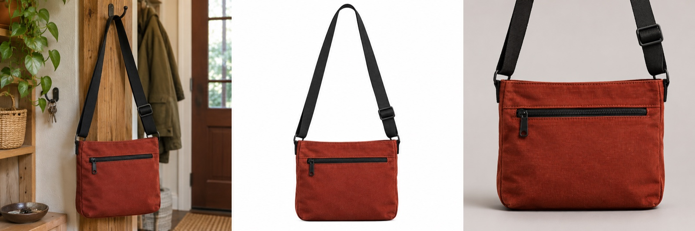

<h1 align="center">PicViva — AI Product Photo Editor</h1>

<strong>AI product photo editing for ecommerce sellers</strong>

  The official GitHub home of PicViva, an AI product photo editor and marketplace image checker for ecommerce sellers.

## What is PicViva?

PicViva is a web-based product photo editor and marketplace image checker for ecommerce sellers. Use it to turn a source photo into a white-background main image, a close-up for a product gallery, or a new composition for an ad or social post.

The workspace keeps your source photos, edited versions, and export options together. You can compare an edit with the original, choose a size for your storefront, and check an image for common listing issues before uploading it.

  <a href="https://picviva.ai/"><strong>Visit PicViva</strong></a> ·
  <a href="https://picviva.ai/en/tools">Explore the tools</a>

## One product photo, two ways to use it

*Example workflow for preparing a listing image and a gallery detail from one product photo.*

| Left · Source photo | Center · Main listing image | Right · Gallery detail |
| --- | --- | --- |
| The bag hangs by the door. The photo shows the whole bag and strap, with an everyday background that can be removed. | A white background makes the bag's shape and full strap easy to see at a glance. Use this framing when preparing a main image for a marketplace listing. | A tighter crop makes the canvas weave, stitching, and zipper easier to inspect. Place it after the full product view in your store's image gallery. |

## All seven PicViva tools

| Tool | What you can do |
| --- | --- |
| [Smart Cutout](https://picviva.ai/en/tools/background-removal) | Remove the background, refine the product edges, and export on white, a custom color, or transparency. |
| [Instruction Edit](https://picviva.ai/en/tools/ai-prompt-edit) | Describe the edit in plain language and apply it to the entire photo or a selected area. |
| [Image Remix](https://picviva.ai/en/tools/image-remix) | Pair a product photo with a reference image to explore different lighting and compositions for listings, ads, and social posts. |
| [Smart Expand](https://picviva.ai/en/tools/smart-expand) | Extend the scene around your product to fit a vertical ad or wide banner. |
| [Resize for Marketplaces](https://picviva.ai/en/tools/resize-for-marketplaces) | Export product images using platform-specific size presets. |
| [Enhance Clarity](https://picviva.ai/en/tools/clarity-enhance) | Sharpen fine details, reduce noise, and optionally upscale an image by 2× or 4×. |
| [Platform Compliance Check](https://picviva.ai/en/tools/amazon-image-compliance-checker) | Check for potential issues with image dimensions, background, text, watermarks, and how much of the frame the product fills. |

## Platform coverage

| Feature | Platforms |
| --- | --- |
| Image export presets | Amazon, Shopify, Etsy, TikTok Shop, Instagram, and Pinterest |
| Image compliance checks | Amazon, Shopify, Etsy, and TikTok Shop |
| Platform-specific image guides | Amazon, Shopify, Etsy, TikTok Shop, Walmart Marketplace, Instagram, and Pinterest |

## Guides for sellers

- [Amazon Product Image Requirements](https://picviva.ai/en/resources/amazon-image-requirements)
- [Shopify Product Image Size Guide](https://picviva.ai/en/resources/shopify-image-size-guide)
- [Resizing Product Images for Amazon, Shopify, and Etsy](https://picviva.ai/en/resources/resize-product-images-amazon-shopify-etsy)
- [TikTok Shop Product Image Requirements](https://picviva.ai/en/resources/tiktok-shop-product-image-requirements)
- [Walmart Marketplace Image Requirements](https://picviva.ai/en/resources/walmart-marketplace-image-requirements)
- [Pinterest and Instagram Product Image Strategy](https://picviva.ai/en/blog/pinterest-instagram-product-image-strategy)
- [Product Image SEO Guide](https://picviva.ai/en/resources/product-image-seo-guide)
